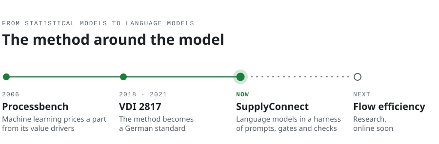

<picture>
  <source media="(prefers-color-scheme: dark)" srcset="https://raw.githubusercontent.com/brian-sieben/brian-sieben/main/assets/hero-dark.svg?v=8">
  
</picture>

I am co-founder and CEO of [SupplyConnect](https://supplyconnect.ch), where I build the control architecture that lets language models connect suppliers to procurement platforms such as SAP Ariba.

**Interests.** System dynamics · machine learning · systems engineering · statistical evaluation without ground truth · control architectures for language models

**Flow efficiency.** My doctoral research, supported by a research grant at the Fraunhofer Institute for Material Flow and Logistics, examines how measures of flow efficiency can be evaluated when no validated reference value is available. This research continues alongside my commercial work.

**Performance pricing.** By coincidence, two things from that research proved useful in an entirely different field, the evaluation of prices: a regression algorithm that is extremely robust and needs very few data points, and the approach of comparing actual values against estimated ones and drawing conclusions from the discrepancy. Processbench (2006 to 2012), a spin-off of the same institute, built both into software that explained the price of a part by its value drivers. Clients included General Motors, ABB, Siemens and McKinsey. Partial exit in 2012. The methodology was later formalised in the German standard VDI 2817; I chaired the committee of the Association of German Engineers (VDI) that published it in two parts: [Part 1 (2018)](https://www.vdi.de/en/home/vdi-standards/details/vdi-2817-blatt-1-performance-pricing-pp-fundamentals-and-application) and [Part 2 (2021)](https://www.vdi.de/en/home/vdi-standards/details/vdi-2817-blatt-2-performance-pricing-pp-commodity-library).

**The buyer's side.** At Hilti (2012 to 2025) I was Head of Sourcing Excellence and, for more than ten years, Global Process Owner Supply; I digitised upstream procurement on SAP Ariba.

**SupplyConnect.** SupplyConnect connects suppliers that still exchange documents outside their customers' procurement systems. It reads those documents and delivers each transaction to the customer's system. Connections to SAP Ariba, SAP Business Network and IGE Competa are live.

The language model is one component of that system. The architecture answers with control loops that detect errors and decide what is released. We select the combination of models for each document type using measured precision, recall and cost.

The requirement comes from the buyer's side: transaction data that meets the buyer's accuracy and validation requirements. The software runs on the customer's premises where data sovereignty requires it, depends on no single frontier model, works with as little fine-tuning as possible, and measures its processing cost per document. A system dynamics model helps us assess the trade-off between human review and further engineering. The code is private.

**Selected publications.** [E-invoicing process reengineering](https://doi.org/10.1108/bpmj-06-2025-1025) (2025) · [The Auction Cube](https://arxiv.org/abs/2105.01154) (2024) · [Suppliers' product compliance risk](https://doi.org/10.1109/IEEM58616.2023.10406973) (2023) · [all publications](https://orcid.org/0000-0002-1949-6320)
